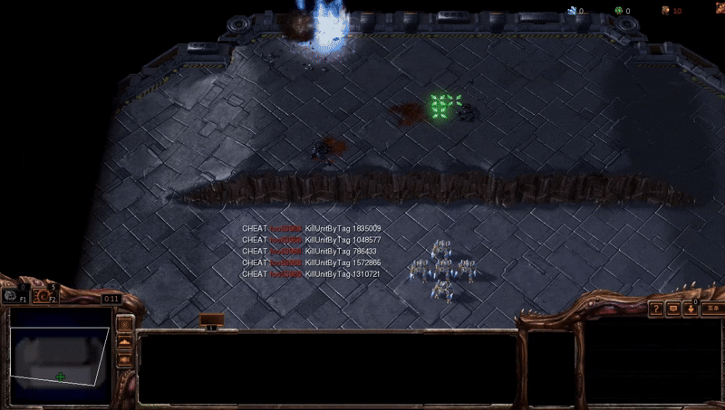
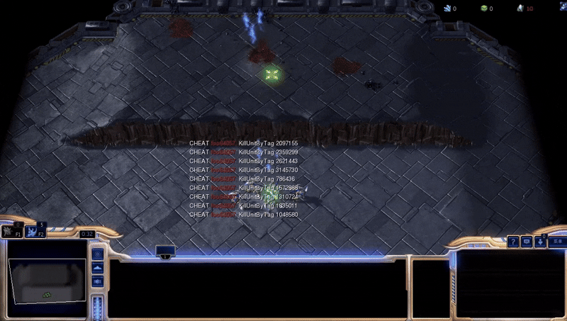
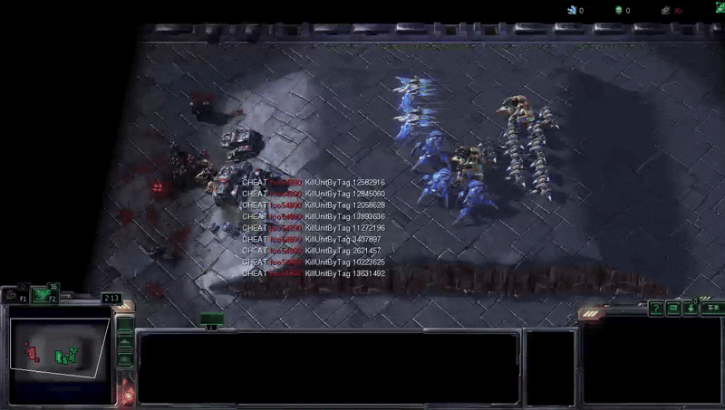
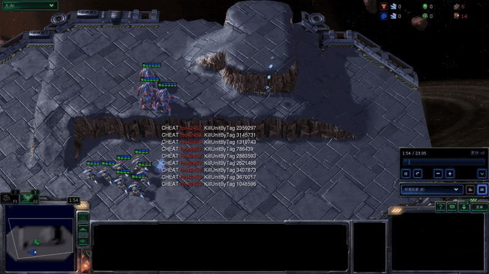

# SMAC-Hard: Enabling Mixed Opponent Strategy Script and Abilities on SMAC

SMAC-HARD V2 IS COMING!

This is the repository of the second version of the paper: SMAC-Hard: Enabling Mixed Opponent Strategy Script and Abilities on SMAC. The first version is in the 'previous-versions\v1' folder. Please refer to the accompanying paper for the outline of our motivation.

[SMAC-HARD](https://github.com/devindeng94/smac-hard) is an extension environment of [SMAC](https://github.com/oxwhirl/smac) for research in the field of cooperative multi-agent reinforcement learning (MARL) based on [Blizzard](http://blizzard.com)'s [StarCraft II](https://en.wikipedia.org/wiki/StarCraft_II:_Wings_of_Liberty) RTS game. SMAC-HARD makes use of Blizzard's [StarCraft II Machine Learning API](https://github.com/Blizzard/s2client-proto) and [DeepMind](https://deepmind.com)'s [PySC2](https://github.com/deepmind/pysc2) to provide a convenient interface for autonomous agents to interact with StarCraft II, getting observations and performing actions. In the opponent script editing mode, users can use pysc2 script based on raw observation to write decision-tree scripts and add them to the opponent strategy pools.

Comparing with the first version, we implement/add:

* Mixed Opponent Strategies including base strategy, attacking the nearest, attacking the weakest, and two LLM-generated scripts for each map.
* Fog of war.
* Abilities such as BLINK, STIMPACK, CHARGE, etc.
* Terrain settings.
* Real agent sights.
* More challenging SC2Maps.

<p align="center">
  
  <br/>
  
  <br/>
  <i>Demos of SMAC-HARD tasks</i>
</p>

# Quick Start

## Installing SMAC-HARD

You can install SMAC-HARD by using the following command:

```shell
pip install git+https://github.com/devindeng94/smac-hard.git
```

Alternatively, you can clone the SMAC-HARD repository and then install `smac_hard` with its dependencies:

```shell
git clone https://github.com/devindeng94/smac-hard.git
pip install -e smac-hard/
```

You may also need to upgrade pip: `pip install --upgrade pip` for the install to work.

## Installing StarCraft II

SMAC-HARD is based on the full game of StarCraft II (versions >= 3.16.1). To install the game, follow the commands bellow.

### Linux

Please use the Blizzard's [repository](https://github.com/Blizzard/s2client-proto#downloads) to download the Linux version of StarCraft II. By default, the game is expected to be in `~/StarCraftII/` directory. This can be changed by setting the environment variable `SC2PATH`.

### MacOS/Windows

Please install StarCraft II from [Battle.net](https://battle.net). The free [Starter Edition](http://battle.net/sc2/en/legacy-of-the-void/) also works. PySC2 will find the latest binary should you use the default install location. Otherwise, similar to the Linux version, you would need to set the `SC2PATH` environment variable with the correct location of the game.

**It is worth noting that the Linux version of StarCraftII binary is version 4.10 and the MacOS/Windows version always follows the latest version (5.0.14 currently), which may result in incompatible performances. For example, the health value of hydralisk is 80 in 4.10 version but 90 in 5.0.14 version, which may significantly influence the difficulty of the 6h\_vs\_8z scenario.**

## SMAC-HARD maps

The Maps are also based on SMAC maps but with multiplayer mode. Therefore, the original SMAC maps are not suitable in the SMAC-HARD environment. To create customised SMAC-HARD maps, you need to create two player positions in the SC2Map and let 'users' control the units instead of Computer AI (internal opponent AI). Before SMAC-HARD can be used, the maps provided in this repository need to be downloaded into the `Maps` directory of StarCraft II. Users should download and extract them to your `$SC2PATH/Maps` directory.

### List the maps

To see the list of SMAC-HARD maps, together with the number of ally and enemy units and episode limit, run:

```shell
python -m smac_hard.bin.map_list 
```


## Saving and Watching StarCraft II Replays

### Saving a replay

If you want to save replays, simply call the `save_replay()` function of SMAC-HARD's StarCraft2Env in your training/testing code. This will save a replay of all epsidoes since the launch of the StarCraft II client.

### Watching a replay

You can watch the saved replay directly within the StarCraft II client on MacOS/Windows by *clicking on the corresponding Replay file*.

You can also watch saved replays by running:

```shell
python -m pysc2.bin.play --norender --replay <path-to-replay> --map_path <path-to-SC2Map>
```

This works for any replay as long as the map can be found by the game. 

For more information, please refer to [PySC2](https://github.com/deepmind/pysc2) documentation.

# Code Examples

## Mixed Opponent Script mode
Below is a small code example which illustrates how **SMAC-HARD mixed opponent script mode** can be used. Here, individual agents execute random policies after receiving the observations and global state from the environment.  

You may apply our proposed SMAC-HARD to your codebase by simply replace 'smac' by **'smac_hard'**!


```python
#from smac.env import StarCraft2Env
from smac_hard.env import StarCraft2Env
import numpy as np

def main():
    env = StarCraft2Env(map_name="8m")
    env_info = env.get_env_info()

    n_actions = env_info["n_actions"]
    n_agents = env_info["n_agents"]

    n_episodes = 5

    for e in range(n_episodes):
        env.reset()
        terminated = False
        episode_reward = 0

        while not terminated:
            obs = env.get_obs()
            state = env.get_state()

            actions = []
            for agent_id in range(n_agents):
                avail_actions = env.get_avail_agent_actions(agent_id)
                avail_actions_ind = np.nonzero(avail_actions)[0]
                action = np.random.choice(avail_actions_ind)
                actions.append(action)

            reward, terminated, _ = env.step(actions)
            episode_reward += reward

        print("Total reward in episode {} = {}".format(e, episode_reward))

    env.close()

```


# Citing  SMAC-HARD 

If you use SMAC in your research, please cite the [SMAC-HARD paper](https://arxiv.org/abs/2412.17707).

In BibTeX format:

```tex
@misc{deng2024smachardenablingmixedopponent,
      title={SMAC-Hard: Enabling Mixed Opponent Strategy Script and Self-play on SMAC}, 
      author={Yue Deng and Yan Yu and Weiyu Ma and Zirui Wang and Wenhui Zhu and Jian Zhao and Yin Zhang},
      year={2024},
      eprint={2412.17707},
      archivePrefix={arXiv},
      primaryClass={cs.AI},
      url={https://arxiv.org/abs/2412.17707}, 
}
```

